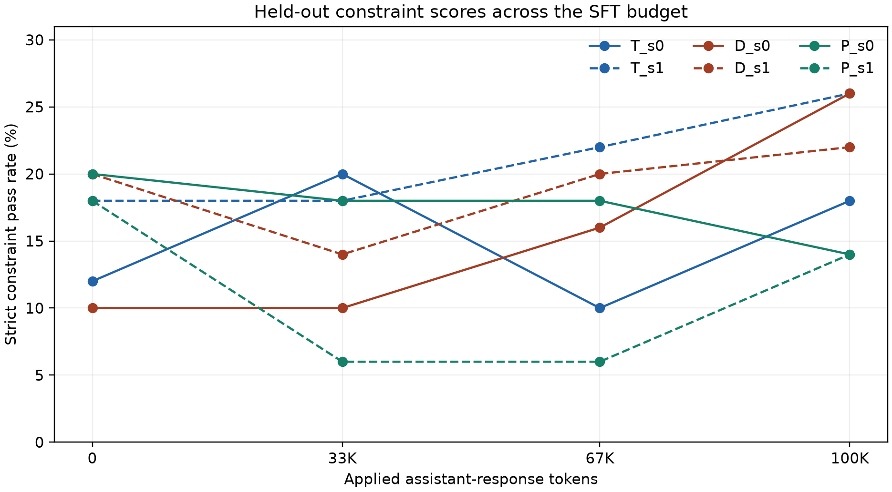

# Nexolve AFML

**Does Differential Transformer V2 learn to follow instructions with less supervision?**

We compare three small language models trained from scratch on FineWeb-Edu and then fine-tuned on instruction-response examples. Each architecture has two runs. Within each seed, the architectures use the same training data order and settings.

| Model | Attention | Parameters |
|---|---|---:|
| T | Standard causal attention | 27,662,848 |
| D | Differential Transformer V2 | 29,260,288 |
| P | Standard causal attention with a wider feed-forward network | 29,284,864 |

P is within 0.084% of D in total parameter count. All three models share a six-layer Llama-style backbone, a 16,384-token tokenizer, and a 1,024-token context. We paired seeds 0 and 1 across models.

We pretrained each run for 4,600 steps (about 301.5 million tokens) on FineWeb-Edu, then fine-tuned the saved models on short SmolTalk conversations. Fine-tuning loss covered assistant-response tokens and the END marker. The budget counts tokens from successful optimizer updates. Each run contributed its pretrained weights and snapshots at 33,000, 67,000, and 100,000 applied response tokens.

## Reproduce the paper results

Start here with Python 3.12. The demo, tests, and saved-prediction checks can run directly from GitHub. The full benchmark also needs the saved model weights, tokenizer, and training record from the download in step 3.

### 1. Set up and check the code

```sh
git clone https://github.com/harish-rameshkumar/nexolve-afml.git
cd nexolve-afml
python -m pip install -r requirements.txt
python -m evaluation.demo --out outputs/evaluation-demo
python -m pytest tests sft/test_masked_loss.py -q
```

The demo writes `outputs/evaluation-demo/report.html`. It shows example scores using fixtures. No GPU or external files are needed for this step.

### 2. Verify the three follow-up results

Run from the repository root. The archive is already included in the clone.

```sh
python -m zipfile -e docs/evaluation-evidence.zip outputs/evaluation-evidence
cd outputs/evaluation-evidence
python work/summarize_ws4_two_fact.py
python work/summarize_ws4_instruction_conflict.py
python work/summarize_ws4_conflict_transfer.py
cd ../..
```

These scripts rescore saved predictions. Here is what to look for in their output:

- **Two-fact retrieval.** A pair passes when the model gives the correct digit followed by END in both prompts. Across the four tested budgets, D had the highest normalized learning-curve area in both seeds. Its mean lead was **2.4 percentage points over T** and **5.4 over P**. T scored higher at the final checkpoint in both seeds with the original wording.
- **Instruction conflict.** P reached and sustained 50% pair accuracy at **192** response-token exposures in both seeds. D reached it at **256 / 288** and T at **288 / 256** for seeds 0 / 1. Exposure counts include repeated examples.
- **Wording transfer.** With conflicting examples at the final measured checkpoint, the models passed **288/288** pair evaluations with familiar wording and **23/576** after rephrasing the same rule.

### 3. Regenerate the main benchmark from the saved models

Download the [paper evaluation assets](https://drive.google.com/drive/folders/1JhTpxHqsIH7sBsVe907WTf2UmF09CBut) and preserve the folder structure. The evaluator needs this layout, where `<run>` is one of `T_s0`, `T_s1`, `D_s0`, `D_s1`, `P_s0`, or `P_s1`:

```text
paper-assets/
  01_TRAINING_RECORDS/training_record.json
  02_PRETRAINED_CHECKPOINTS/<run>/final.pt
  03_SFT_CHECKPOINTS/<run>/checkpoints/sft_33000.pt
  03_SFT_CHECKPOINTS/<run>/checkpoints/sft_67000.pt
  03_SFT_CHECKPOINTS/<run>/checkpoints/sft_100000.pt
  04_DATA_AND_TOKENIZER/tokenizer.json
```

From the repository root, replace `PATH_TO_PAPER_ASSETS` with the path to the folder containing those four subfolders. The first command checks real checkpoint loading and scoring. The second runs all **24 checkpoints × 50 prompts** on CPU.

```sh
python -m evaluation.evaluate_instruction_checkpoints --asset-root "PATH_TO_PAPER_ASSETS" --protocol evaluation/benchmarks/instruction_constraints_v1/protocol.json --out outputs/checkpoint-check.json --quick-check
python -m evaluation.evaluate_instruction_checkpoints --asset-root "PATH_TO_PAPER_ASSETS" --protocol evaluation/benchmarks/instruction_constraints_v1/protocol.json --out outputs/instruction-scores.json
```

The evaluator verifies the artifact hashes and recorded budgets. It generates answers greedily with a 64-new-token limit and scores each prompt's constraint. The full run took about 15 minutes of CPU generation in the recorded environment. The output JSON includes responses, pass rates, limit hits, and normalized learning-curve areas.

**Expected strict pass rates**. Each entry is the percentage of 50 prompts passed at that budget.

| Run | 0 | 33K | 67K | 100K |
|---|---:|---:|---:|---:|
| T, seed 0 | 12% | 20% | 10% | 18% |
| T, seed 1 | 18% | 18% | 22% | 26% |
| D, seed 0 | 10% | 10% | 16% | 26% |
| D, seed 1 | 20% | 14% | 20% | 22% |
| P, seed 0 | 20% | 18% | 18% | 14% |
| P, seed 1 | 18% | 6% | 6% | 14% |



T had a higher normalized learning-curve area than D in both seeds. All 1,200 answers reached the generation limit, and keyword checks accounted for 170 of the 198 passes. Across the main benchmark and follow-ups, we found no consistent instruction-learning advantage for D. [Machine-readable scores and checkpoint hashes](docs/benchmark-scores.csv)

## Training and source code

The table records the two training stages. The reproduction steps above start with the saved checkpoints.

| Stage | Data and training | Where to inspect the code |
|---|---|---|
| Pretraining | FineWeb-Edu `sample-10BT`, next-token prediction, fixed validation split. Final mean validation loss was 3.5208 for T, 3.5181 for D, and 3.5125 for P. | [Training code](pretraining/) · [Pretraining commands and configuration](docs/pretraining.md) · [Dataset](https://huggingface.co/datasets/HuggingFaceFW/fineweb-edu/viewer/sample-10BT) |
| Supervised fine-tuning | SmolTalk `smol-magpie-ultra`, with 2,278 training examples and 253 validation examples after filtering. At 100K tokens, mean validation NLL was 2.81913 for T, 2.80240 for D, and 2.80711 for P. | [Fine-tuning code](sft/) · [Training notes](docs/supervised-fine-tuning.md) · [Dataset](https://huggingface.co/datasets/HuggingFaceTB/smoltalk/viewer/smol-magpie-ultra) |

The public fine-tuning code runs the pilot recipe. Recreating the paper checkpoints requires the exact trainer used for the final runs. [Model code](models/) · [Evaluation code](evaluation/) · [Recorded environment and prepared training data](docs/reproduction.md)
