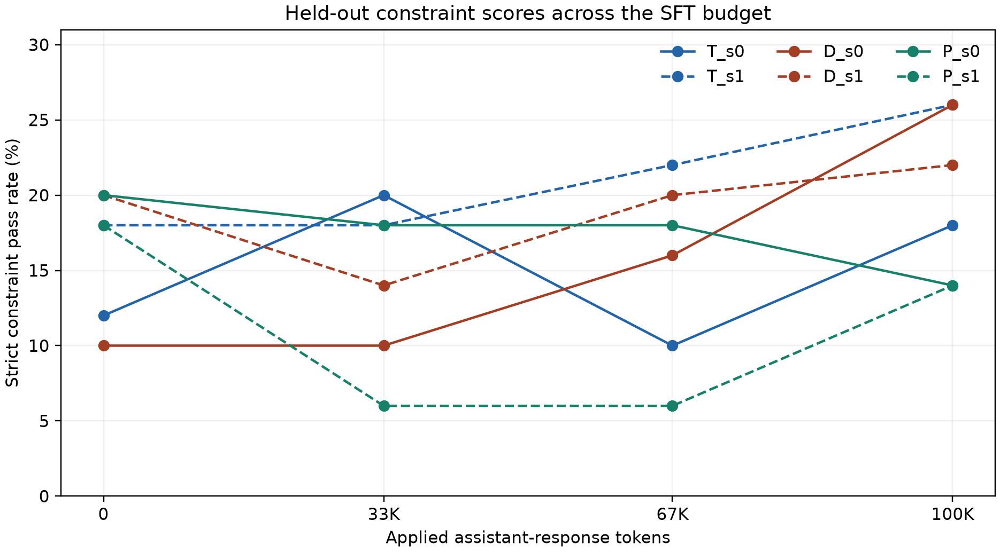

# Results and limitations

## General instruction following

Differential Transformer V2 (D) had a lower learning-curve score than standard attention (T) in both seeds. Its ranking against the parameter-matched control (P) changed across seeds. All 1,200 responses reached the generation limit, and keyword inclusion accounted for 170 of 198 passes. These limitations make the scores a descriptive measure of constraint compliance.

## Synthetic follow-ups

- **Two-fact retrieval.** D led on average across the tested budgets in both seeds, by 2.4 percentage points over T and 5.4 over P. T scored higher at the final checkpoint in the original wording.
- **Conflicting examples.** P reached the fixed 50% accuracy target at 192 supervised token exposures in both seeds. D reached it at 256 and 288. The comparison between D and T split by seed. These budgets are observed checkpoints and include repeated exposures.
- **Wording transfer.** At the final conflict checkpoint, the six runs passed 288/288 pairs across two example layouts with the familiar instruction wording. They passed 23/576 pairs across two equivalent rewordings. The efficiency ranking applies to the familiar wording.

Two paired seeds give a limited view of reproducibility. P matches D in total size but assigns its extra parameters to the feed-forward network. The results leave open whether differential attention improves instruction-learning efficiency across tasks and prompt formats.
